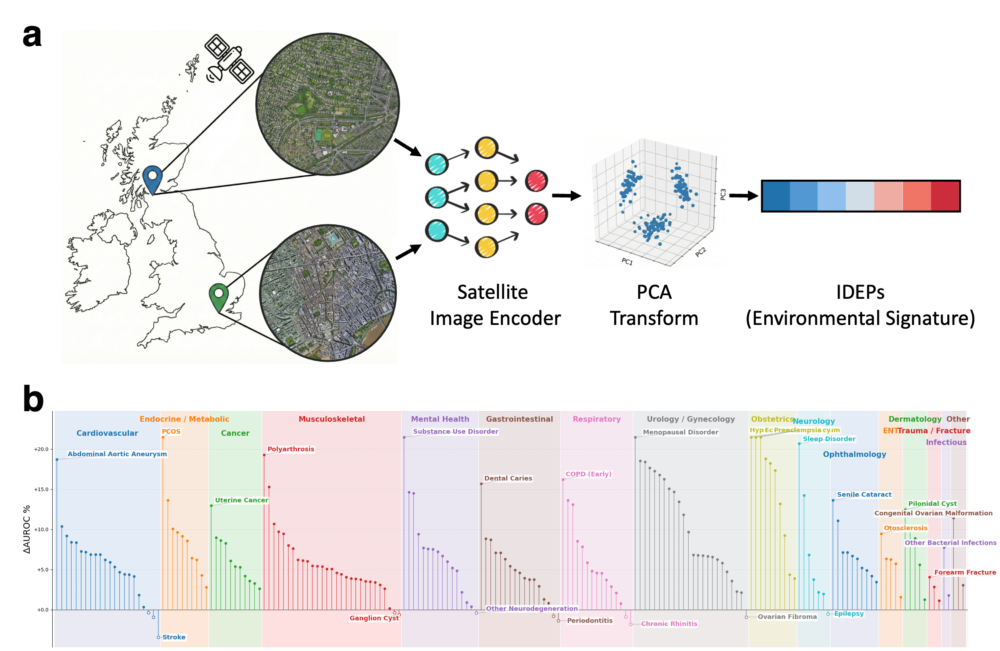

# IDEPs: Image-Derived Environmental Phenotypes

The residential environment is a fundamental determinant of chronic disease risk, yet quantifying individual-level environmental context at population scale remains a major challenge. Here we introduce **Image-Derived Environmental Phenotypes (IDEPs)**, individual-level environmental signatures extracted from residential satellite imagery.

Applied to 308,423 UK Biobank participants across 188 disease phenotypes, IDEPs combined with polygenic risk scores yielded significant predictive improvements in both cross-sectional prevalence and longitudinal incidence prediction, improving screening efficiency by up to 51% in select phenotypes. Mediation analysis revealed that IDEPs partially mediate established lifestyle and environmental pathways while retaining a significant residual direct effect unexplained by conventional covariates. Furthermore, individuals carrying both high genetic and high environmental burden showed up to 24-fold increased disease risk, demonstrating that IDEPs encode information independent of genomic risk.

Together, these findings position IDEPs as a scalable, quantifiable environmental signature for population health, complementing genomic approaches in precision medicine.

## Overview



**Figure 1. Overview of IDEPs.**
**(a)** Schematic of the extraction pipeline. Residential satellite imagery is processed by a deep learning model to extract comprehensive environmental representations. These features are subsequently condensed into compact latent coordinates that jointly capture structural characteristics of both the built and natural environment.
**(b)** Phenome-wide improvement in disease prediction. The addition of IDEPs to baseline genetic models resulted in predictive performance gains for 93.65% of phenotypes, with statistically significant improvements confirmed in 74.6% of cases. This suggests that satellite-derived signatures capture substantial environmental risk information independent of genetic susceptibility.
PCA, principal component analysis; PRS, polygenic risk score.

## Pipeline

```
[1] Download BEV Images    Google Maps Static API -> satellite images
         |
[2] Train DINOv2           Self-supervised ViT-Base pretraining
         |
[3] Extract Features       768-dim feature vectors per image
         |
[4] PCA Compression        30 principal components (IDEPs)
         |
    +----+----+
    |         |
[5] Prevalence         [6] Incidence
    Prediction              Prediction
    (Random Forest)         (Cox PH Model)
```

## Directory Structure

```
IDEPs/
├── data/                          # Sample data (10 UK landmarks for demo)
│   ├── sample_coordinates.tsv     # BNG coordinates for image download
│   ├── df_labels.csv              # Disease labels (T2D)
│   ├── df_prs.csv                 # Polygenic Risk Scores
│   ├── df_cov.csv                 # Covariates (age, sex, lifestyle)
│   ├── df_ses.csv                 # Socioeconomic status indicators
│   ├── df_IDEPs_level_15.csv      # PCA-transformed image features
│   └── incidence_labels.csv       # Incidence labels with follow-up time
├── source/
│   ├── bev_image_parser/          # Satellite image downloader
│   ├── dinov2/                    # DINOv2 self-supervised learning framework
│   ├── feature_extraction/        # Feature extraction from trained model
│   ├── pca/                       # PCA dimensionality reduction
│   ├── prevalence_prediction/     # Random Forest prevalence prediction
│   └── incidence_prediction/      # Cox PH incidence prediction
├── script/                        # Shell scripts for each pipeline step
├── requirements.txt
└── README.md
```

## Prerequisites

- Python 3.9+
- CUDA-compatible GPU (for DINOv2 training and feature extraction)
- Google Maps Static API key (for image download)

## Installation

```bash
pip install -r requirements.txt

# Install DINOv2 as editable package
cd source/dinov2 && pip install -e .
```

## Usage

### Step 1: Download BEV Images

Requires a Google Maps API key and URL signing secret.

```bash
bash script/01_download_images.sh
```

Edit the script to set your API key and signature file paths.

### Step 2: Train DINOv2

Train a ViT-Base model with DINOv2 self-supervised learning on the downloaded images. Requires 4 GPUs.

```bash
bash script/02_train_dino.sh
```

### Step 3: Extract Features

Extract 768-dimensional feature vectors from images using the trained model.

```bash
bash script/03_extract_features.sh
```

### Step 4: PCA Compression

Reduce features to 30 principal components (IDEPs).

```bash
bash script/04_run_pca.sh
```

### Step 5: Prevalence Prediction

Run Random Forest classification comparing:
- **Base model**: Covariates + PRS
- **Full model**: Covariates + PRS + SES + Lifestyle + IDEPs (residualized)

Includes DeLong test for statistical comparison of AUROCs.

```bash
bash script/05_run_prevalence_prediction.sh
```

### Step 6: Incidence Prediction

Run Cox Proportional Hazards models on pre-built incidence labels with:
- C-index evaluation (K-fold CV)
- Paired T-test for model comparison
- NNS (Number Needed to Screen) contextualization

```bash
bash script/06_run_incidence_prediction.sh
```

## Data Format

### Input Data

| File | Columns | Description |
|------|---------|-------------|
| `sample_coordinates.tsv` | eid, home_location_east_coordinate, home_location_north_coordinate | BNG (EPSG:27700) coordinates |
| `df_labels.csv` | eid, {phenotype} | Binary disease labels |
| `df_prs.csv` | eid, {phenotype} | Standardized polygenic risk scores |
| `df_cov.csv` | eid, age, sex, lifestyle_label | Covariates |
| `df_ses.csv` | eid, tdi_score, education_score, income_score | Socioeconomic indicators |
| `df_IDEPs_level_15.csv` | eid, PC1, ..., PC30 | PCA-transformed image features |
| `incidence_labels.csv` | eid, label, followup_days, phenotype, endpoint | Time-to-event data |

### Model Comparison

The pipeline evaluates the incremental predictive value of IDEPs by comparing:

1. **Base model** (Cov + PRS): Standard genetic risk prediction
2. **Full model** (Cov + PRS + SES + Lifestyle + IDEP_residual): Enhanced prediction with residualized image features

IDEPs are residualized against SES and lifestyle variables to isolate the unique contribution of built environment features captured by satellite imagery.

## API Key Setup

Image download requires Google Maps Static API credentials:

1. Obtain a Google Maps Static API key from [Google Cloud Console](https://console.cloud.google.com/)
2. Generate a URL signing secret
3. Save each to a separate text file
4. Update paths in `script/01_download_images.sh`

**Never commit API keys to version control.**

## Notes

- The included sample data uses 10 UK landmark coordinates for demonstration purposes
- For production use, replace with actual UK Biobank participant coordinates
- DINOv2 training requires significant compute resources (4+ GPUs recommended)
- The `xformers` package is optional but recommended for efficient attention computation
